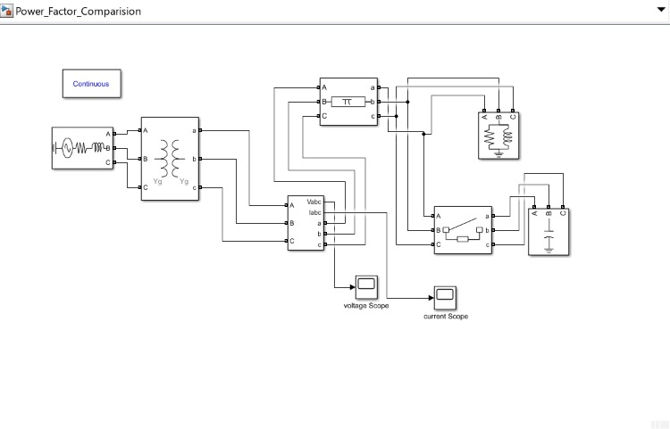
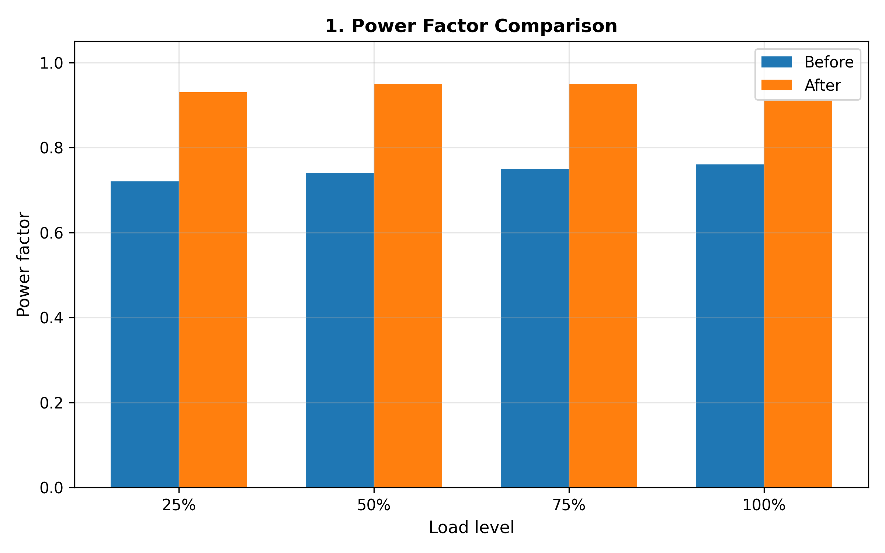
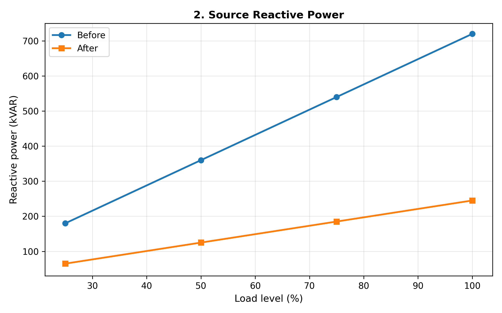
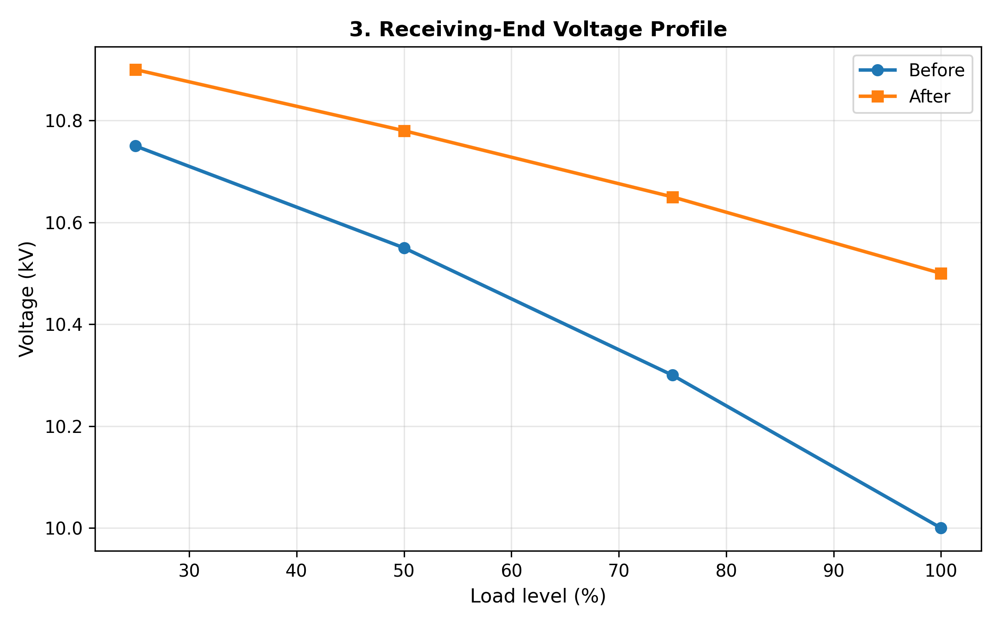
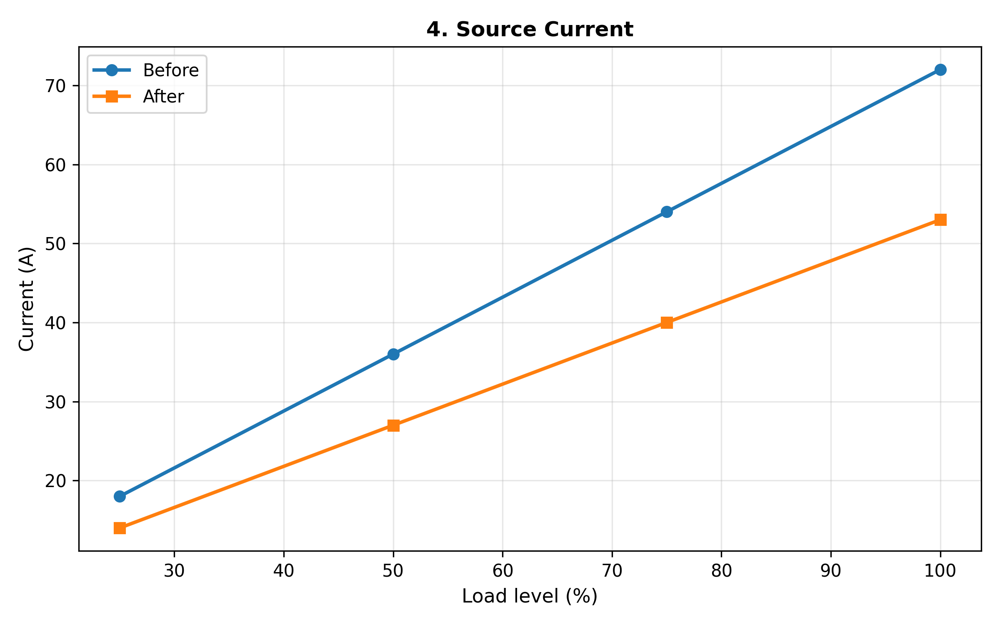
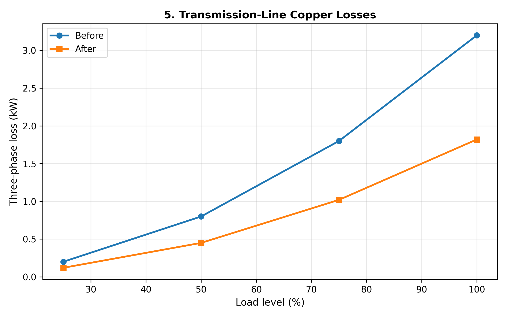
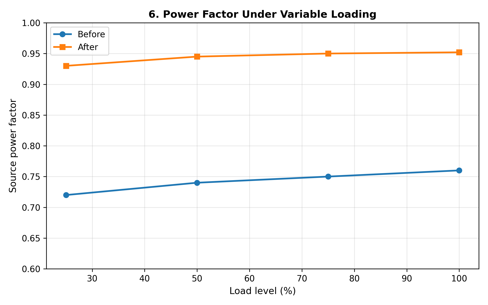
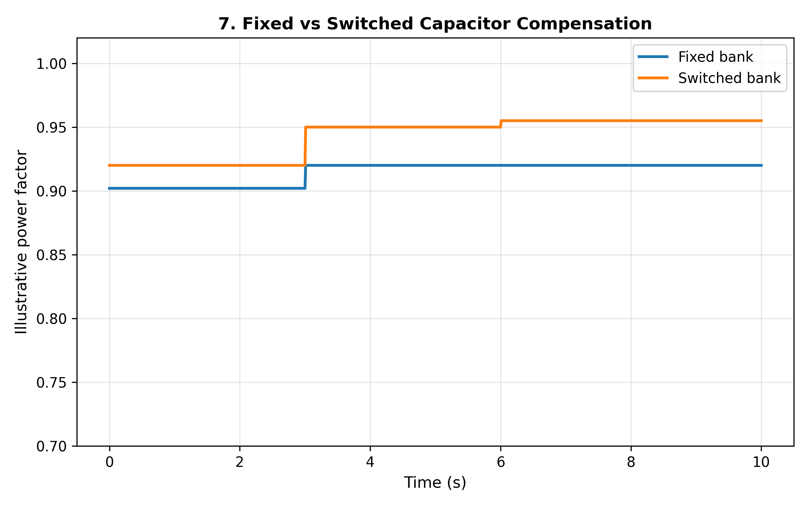
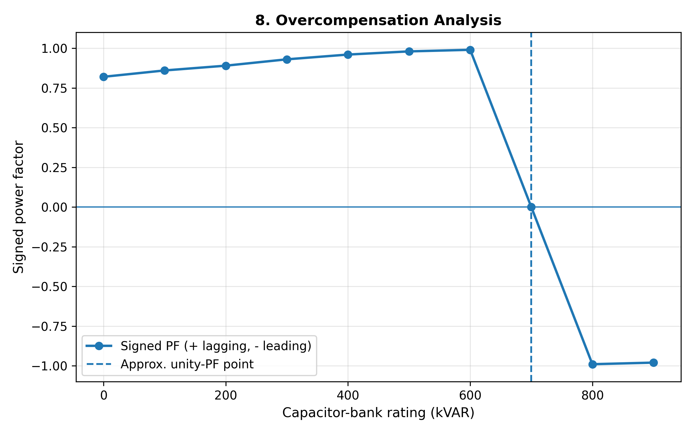

# Optimal Shunt Capacitor Compensation in Distribution Networks

Simulation and analysis of power factor correction, voltage profile improvement, line loss reduction, and overcompensation behavior in a 415V/50Hz distribution network using MATLAB/Simulink.

---

## 📐 Simulink Model Schematic

---

## 📊 Results & Performance Graphs

### 1. Power Factor Comparison

### 2. Source Reactive Power

### 3. Receiving-End Voltage Profile

### 4. Source Current

### 5. Transmission-Line Copper Losses

### 6. Power Factor Under Variable Loading

### 7. Fixed vs Switched Capacitor Compensation

### 8. Overcompensation Analysis

---

## 🛠️ Methodology & Scope
* **Network Parameters:** 415V, 50Hz three-phase distribution system.
* **Load Variations:** Tested across 25%, 50%, 75%, and 100% active and reactive load levels.
* **Compensation Strategy:** Shunt capacitor bank integration via controlled switching breakers to optimize power factor toward unity and minimize line losses.
